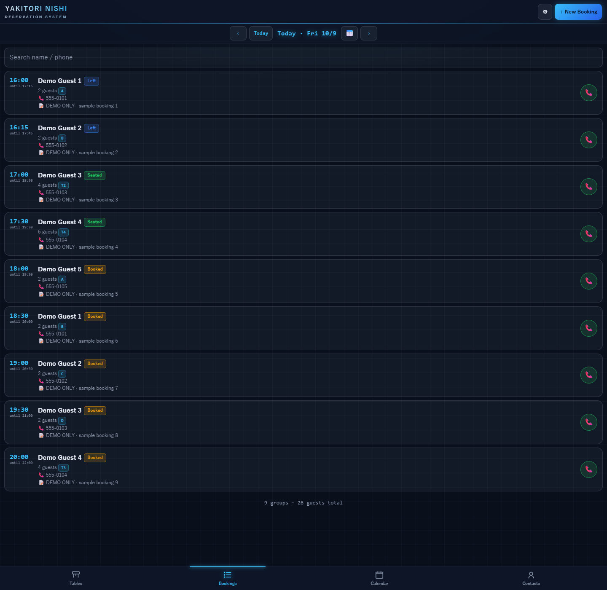
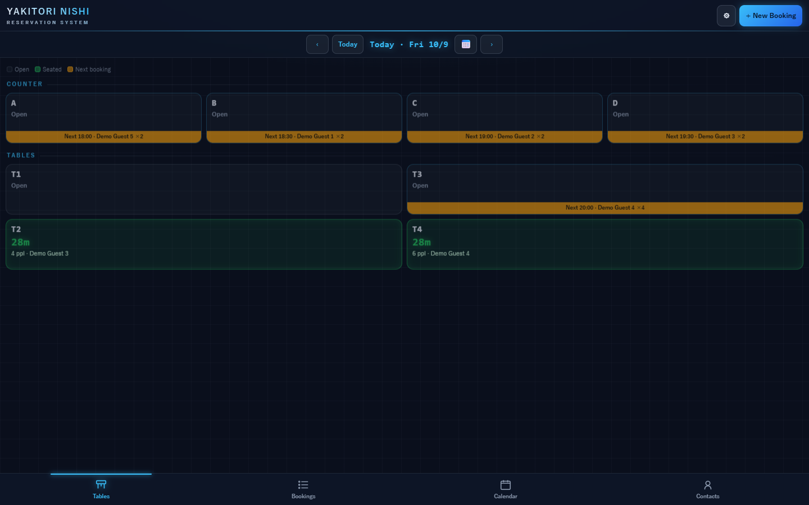
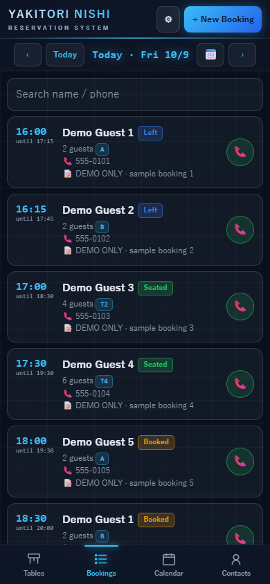
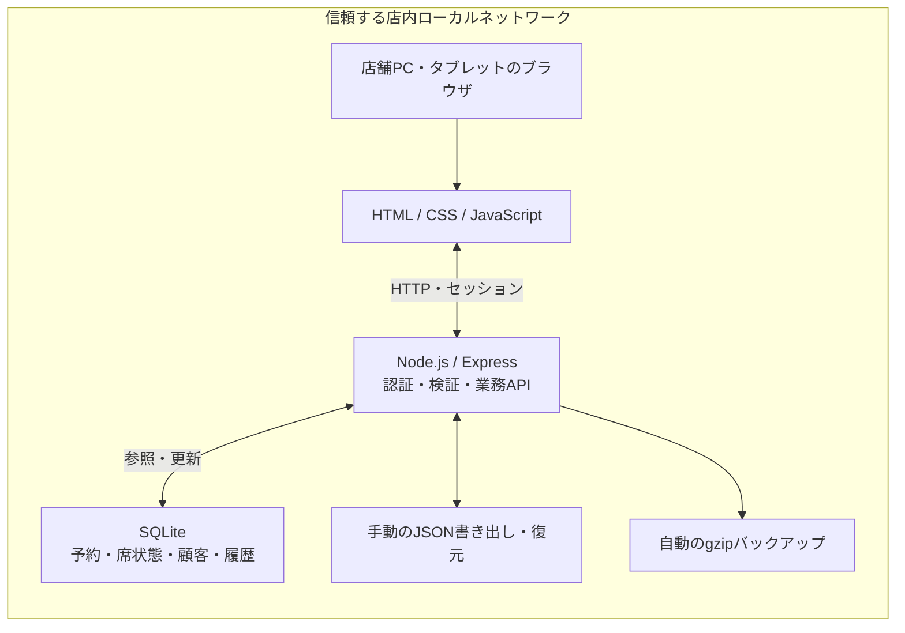

# NISHI Board — 予約・席・顧客管理アプリ

Reservation, seating, and guest management for YAKITORI NISHI in Los Angeles. 
Documentation and fictional-data screenshots only; application source is private. 
Designed for one restaurant PC and tablets on a trusted local network.

> このリポジトリは就職活動向けの紹介資料です。アプリ本体のソースコードは非公開です。掲載画像はすべて架空のデモデータで、実際の顧客情報・認証情報は含みません。

## 概要

ロサンゼルスの焼き鳥店 YAKITORI NISHI の店内業務に使うために作った、予約・席・顧客管理アプリです。 
店舗PCでサーバーを動かし、PCや店内タブレットのブラウザから同じデータを扱います。 
予約の予定と現在の着席状態を分け、来店記録・予約の変更履歴を保存します。

## 解決する課題

- **二重予約の見落とし**：同じ営業日・同じ卓で時間帯が重なる予約を検出し、確認を求めます。
- **席の状況の伝達漏れ**：空席・着席・退店をサーバーで共有し、各端末の画面へ反映します。
- **来店・変更の経緯が追えない**：顧客ごとの来店記録と、予約変更の履歴を分けて保存します。
- **深夜予約の日付の混乱**：16:00〜翌01:00の営業時間を扱い、深夜の予約も店舗の営業日として計算します。

## 主な機能

- 日付別の予約一覧・検索・カレンダー／時間帯表示
- 複数卓の選択、卓の移動・入れ替え、予約時間の重複確認
- 予約からの着席、Walk-in、退店・取消、閉店まで利用するFREE TIME
- 電話番号の正規化による顧客の紐付けと来店履歴
- Staff／Adminの権限分離、JSON入出力、自動バックアップ・復元

## 画面イメージ

以前に作成したデモ画像を再利用しています。表示される「Demo Guest」と555で始まる番号は架空のものです。

### 予約一覧・PC表示

### 卓の配置図・PC表示

スマートフォン表示を見る

## 技術構成と選んだ理由

| 技術 | 用途と選択理由 |
|---|---|
| Node.js / Express | 店舗PC上で画面配信とHTTP APIをまとめて動かすため |
| SQLite / better-sqlite3 | 別のDBサーバーを置かず、1台の店舗PCでデータを保持するため |
| HTML / CSS / JavaScript | フロントエンドのビルド工程を設けず、ブラウザで業務画面を使うため |
| Node.js標準テストランナー | 追加のテストフレームワークなしで、一時DBによるAPI回帰テストを行うため |

大規模な分散システムではなく、店舗PC1台と店内端末という運用範囲に合わせた構成です。

## システム構成

既存の構成図を紹介用に要約しています。

[構成図の補足はこちら](docs/diagrams/README.md)

## 設計で工夫した点

### 予約の計画と、現在の卓状態を分離

未来の予約があることと、今その卓が使用中であることを同じ状態にしません。 
当日の来店状態は卓へ反映し、過去の来店訂正は履歴として扱います。

### 重複予約と、古い画面からの操作を区別

同日・同卓の時間帯重複は409で知らせ、確認付きの例外と、使用中の卓を上書きできない条件を分けています。 
編集時は取得時点の更新時刻を照合し、他端末による変更後の古い編集を拒否します。 
退店・取消では、シートを開いたときの予約IDを現在の使用者と照合します。

### 店舗のタイムゾーンと深夜営業

営業日を翌01:00で区切り、サーバーの計算をAmerica/Los_Angelesに固定しています。 
00:30の予約を、前日から続く営業時間の一部として扱います。

### 予約を基準にした復元

置き換え復元は、全行を正規化・検証してから書き込みます。不正行があれば既存データを変更せず中止します。 
merge復元では、実際に書き込んだ予約から来店履歴・当日の卓状態を整合させ、別予約が使用中の卓を上書きしません。

## 品質の確認

2026-11-07（日本時間）、Node.js 24.22.1で既存のAPI回帰テストを再確認しました。

| 外側のタイムゾーン | 最終実行の成功件数 | 失敗・skip |
|---|---|---|
| TZ未指定 | 52 / 52 | 0 / 0 |
| Asia/Tokyo | 52 / 52 | 0 / 0 |
| America/Los_Angeles | 52 / 52 | 0 / 0 |

実行時の補足

初回のTZ未指定実行では、一時サーバーの起動待ちで3件が約20秒のタイムアウトになりました。コード・期待値・待ち時間は変えず、再実行で52件すべて成功しました。東京・ロサンゼルス条件は初回から全件成功しています。起動時間の環境依存については原因を特定できておらず、検証上の課題として残しています。

| 確認する境界 | テストの内容 |
|---|---|
| 入力と営業時間 | 日付・人数・卓ID重複、FREE TIMEの開始時刻、深夜の営業日 |
| 複数端末の操作 | 古い編集、古い卓シート、卓移動・入れ替えの競合 |
| 状態と永続化 | 着席・退店・取消、再送、バックアップと再起動後の保持 |
| 顧客と履歴 | 電話番号による紐付け、空番号・重複番号、来店と変更の記録 |
| 復元 | 不正な置き換え復元の無変更中止、merge後の履歴・卓状態 |
| 認証と入力エラー | 未認証・役割・Origin、不正JSON・圧縮リクエストなど |
| デモデータの保護 | DB指定なし・既存予約ありの条件で書き込まないこと |

テストはコードをプロジェクト外の一時フォルダへコピーし、架空DB・ダミー認証・一時バックアップだけを使います。実店舗のデータや認証設定は使いません。

## 開発の進め方

個人開発のプロジェクトです。開発・監査・修正ではAI（Codex・Claude）を補助に利用しています。 
業務ルール、公開範囲、テストの仕様変更の判断・承認は、開発者自身が行っています。

## 公開範囲と既知の制約

- このリポジトリは説明資料と架空データ画像だけを掲載し、本体のGit履歴は引き継いでいません。
- アプリ本体のソースコード、店舗DB、顧客情報、認証設定、実バックアップは非公開です。
- 実アプリは信頼する店内LAN向けです。この紹介ページで実アプリをインターネットへ公開するものではありません。
- HTTP、メモリ上のセッション、単一サーバーという運用上の制約があります。
- ブラウザ側の日付は端末のタイムゾーンにも依存するため、店内端末の時刻設定を合わせる必要があります。

## 今後の改善候補

1. ブラウザ側の日付・当日判定も、サーバーの店舗営業日に合わせる。
2. 架空データを増やし、復元・バックアップの負荷と処理時間を測定する。
3. 店内運用上の必要性を確認したうえで、操作権限・ログイン状態の永続化を検討する。
