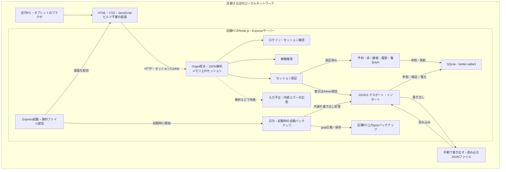

# NISHI Board — システム全体構成図

既存の構成図をもとに、実装ファイルへの参照を省いた紹介用の図です。

## この図で伝えたいこと

店内のブラウザから、店舗PC1台のサーバーに接続する構成です。 
業務データはSQLiteに保存し、手動のJSON入出力と自動バックアップは共通の書き出し処理を使います。 
インターネット公開用の構成ではなく、紹介ページに実データや実装コードは含めていません。

[紹介ページへ戻る](../../README.md)
